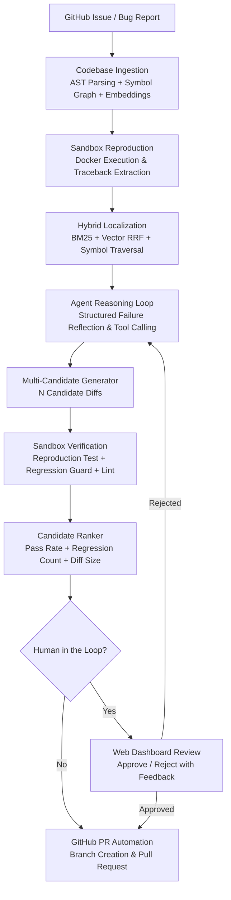

# Fixion 🔧

**Autonomous SWE Agent with Closed-Loop Reproduction, Hybrid Localization, and Regression-Guarded Patching**

Fixion is a production-grade autonomous software engineering agent designed for end-to-end bug resolution on real-world codebases. Given a GitHub issue or failing test specification, Fixion executes an autonomous closed-loop workflow: it reproduces the defect inside a hardened Docker sandbox, pinpoints the root cause using AST symbol graphs and hybrid search, generates multi-candidate surgical patches, guards against regressions, and automatically opens clean Pull Requests with human-in-the-loop review.

[](https://github.com/Supratik24/Fixion/actions/workflows/ci.yml)
[](https://www.python.org/downloads/)
[](https://opensource.org/licenses/MIT)

---

## 🌟 Key Capabilities

- **Reproduction-First Defect Verification**: Never guesses fixes blind. The `reproduce_issue` tool executes failing tests inside a containerized sandbox to extract real tracebacks and confirm defect repeatability before generating any code changes.
- **Hybrid Codebase Localization**: Combines tree-sitter AST parsing, NetworkX call/import graphs, BM25 lexical search, and LanceDB dense vector embeddings with Reciprocal Rank Fusion (RRF) for pinpoint accuracy down to the exact file, symbol, and line.
- **Multi-Candidate Patch Generation & Ranking**: Generates $N$ diverse candidate patches and executes automated ranking based on reproduction pass rate, regression suite pass rate, `ruff` / `mypy` static analysis scores, and minimal diff size.
- **Regression Guard with Auto-Revert**: Safeguards existing functionality by executing the full regression suite against candidate patches, automatically reverting regressions before presenting solutions.
- **Hardened Execution Sandbox**: Runs untrusted code inside isolated Docker containers with non-root privileges (`user="sandbox"`), complete network isolation (`network_mode="none"`), hard memory ceilings (`mem_limit="2g"`), and CPU quota throttling.
- **Interactive Web UI & REST API**: Full-featured FastAPI dashboard (`http://localhost:8000`) for monitoring active agent jobs, inspecting live execution logs, reviewing unified diffs, and approving or rejecting patches in Human-in-the-Loop (HITL) mode.
- **GitHub Integration**: Direct GitHub issue ingestion from URLs and automated Pull Request creation via the GitHub REST API.

---

## 🏗️ Architecture



### Module Layout

```
Fixion/
├── agent/                  # Agent reasoning loop & tools
│   ├── loop.py             # Multi-turn tool-calling controller & failure reflection
│   ├── llm_client.py       # Unified multi-backend client (Gemini, Groq, OpenRouter)
│   ├── prompts.py          # System prompts, localization, and patch templates
│   └── tools/              # 16 atomic tools (search, read, patch, test, git, candidates)
├── ingest/                 # Repository ingestion & indexing
│   ├── clone.py            # Git cloning & workspace setup
│   ├── ast_parser.py       # Tree-sitter AST chunker (functions, classes, methods)
│   ├── symbol_graph.py     # NetworkX symbol import/call hierarchy
│   ├── embed_index.py      # Dense vector embeddings (Gemini/LanceDB)
│   └── hybrid_search.py    # BM25 + Vector RRF retrieval engine
├── sandbox/                # Hardened container execution
│   ├── docker_runner.py    # Docker sandbox runner with security limits
│   └── Dockerfile.base     # Unprivileged sandbox container image
├── storage/                # State persistence & database
│   └── db.py               # SQLite jobs table & thread-safe session manager
├── eval/                   # Benchmark evaluation harness
│   ├── swebench_harness.py # SWE-bench Lite test harness
│   └── metrics.py          # Standardized metric reporting (resolve rate, cost, latency)
├── static/                 # Web Dashboard frontend assets
│   ├── index.html          # Interactive single-page dashboard
│   ├── app.js              # Real-time state management & polling
│   └── styles.css          # Modern dark-mode UI styling
├── tests/                  # Offline unit & integration test suite
├── api.py                  # FastAPI REST API & Web UI server
├── cli.py                  # Click CLI interface
└── config.py               # Pydantic v2 application settings
```

---

## 🚀 Quick Start

### Prerequisites

- **Python**: 3.11 or higher
- **Docker Desktop**: Running locally
- **LLM API Key**: At least one of:
  - [Google Gemini API Key](https://aistudio.google.com/app/apikey) (Recommended)
  - [Groq API Key](https://console.groq.com/keys)
  - [OpenRouter API Key](https://openrouter.ai/keys)
- **GitHub Token**: Optional (required for private repos and automated PR creation)

### 1. Installation

```bash
git clone https://github.com/Supratik24/Fixion.git
cd Fixion

# Create and activate virtual environment
python -m venv .venv
source .venv/bin/activate  # Windows: .venv\Scripts\activate

# Install dependencies
pip install -e ".[dev]"
```

### 2. Configuration

Copy `.env.example` to `.env` and provide your credentials:

```bash
cp .env.example .env
```

```ini
# LLM Configuration
GEMINI_API_KEY=your_gemini_api_key_here
FIXION_BACKEND=gemini          # "gemini" | "groq" | "openrouter"
FIXION_MODEL=gemini-2.5-pro    # or "gemini-3.8-flash", "llama-3.3-70b-versatile"

# GitHub Integration (Optional)
GITHUB_TOKEN=ghp_your_personal_access_token_here

# Sandbox Security Controls
FIXION_SANDBOX_MEMORY=2g
FIXION_SANDBOX_CPUS=2.0
FIXION_SANDBOX_NETWORK=none
FIXION_SANDBOX_TIMEOUT=300
```

### 3. Build Docker Sandbox (One-Time)

```bash
fixion build-sandbox
```

---

## 💻 Usage

### Option A: Web Dashboard (Recommended)

Launch the interactive web UI and API server:

```bash
python -m uvicorn api:app --host 127.0.0.1 --port 8000 --reload
```

Open your browser at **`http://localhost:8000`** to:
1. Submit bug fixes using a repository path or GitHub issue URL.
2. Monitor real-time agent execution logs, token usage, and latency.
3. Inspect unified diff previews with syntax highlighting.
4. Approve, reject, or comment on candidate patches before PR submission.

### Option B: Command Line Interface (CLI)

Fix a bug from a local or remote repository:

```bash
fixion fix \
  --repo https://github.com/psf/requests \
  --issue "ConnectionError raised when response has no Content-Length header" \
  --test "tests/test_adapters.py::test_stream_response"
```

Ingest directly from a GitHub issue URL:

```bash
fixion fix \
  --issue-url https://github.com/psf/requests/issues/1234 \
  --create-pr
```

Pre-index a codebase for accelerated localization:

```bash
fixion index --repo https://github.com/psf/requests
```

Run ablation experiments (disabling symbol graph or semantic search):

```bash
fixion fix \
  --repo ./my_repo \
  --issue "Fix off-by-one error in pagination" \
  --no-symbol-graph \
  --no-semantic-search
```

---

## 🔒 Sandbox Security Architecture

Fixion treats all target repositories and LLM-generated code as untrusted. Container execution is locked down across four defense-in-depth layers:

| Security Vector | Mechanism | Protection |
|---|---|---|
| **Network Isolation** | `network_mode="none"` | Eliminates all inbound and outbound network access. Disables data exfiltration, reverse shells, and external package fetching during execution. |
| **Unprivileged Execution** | `user="sandbox"` | Runs container commands under an unprivileged user (UID/GID 1000) rather than `root`, mitigating host-escape vulnerabilities. |
| **Memory Capping** | `mem_limit="2g"` | Imposes a strict 2 GB memory ceiling enforced by Linux cgroups. Prevents memory bombs and host OOM conditions. |
| **CPU Quota Throttling** | `nano_cpus=2_000_000_000` | Limits container execution to a maximum of 2.0 cores, preventing infinite loops or compute exhaustion. |
| **Ephemeral Filesystem** | Volume workspace mounts | Test executions run inside isolated transient volumes; host repositories are never modified directly until candidate verification succeeds. |

---

## 🤖 Supported LLM Backends

Fixion features a multi-backend client (`agent/llm_client.py`) supporting top-tier reasoning and coding models:

| Provider | Recommended Model | `FIXION_BACKEND` | Notes |
|---|---|---|---|
| **Google Gemini** | `gemini-2.5-pro` / `gemini-3.8-flash` | `gemini` | Native function calling, low latency, extensive context window. |
| **Groq** | `llama-3.3-70b-versatile` | `groq` | Ultra-fast inference with native tool-calling support. |
| **OpenRouter** | `deepseek/deepseek-r1` | `openrouter` | Open access to DeepSeek reasoning models, Claude 3.5 Sonnet, and GPT-4o. |
| **Ollama / Local** | `qwen2.5-coder:32b` | `openrouter` | Fully local execution via OpenAI-compatible local endpoints. |

---

## 📊 Benchmark Results (SWE-bench Lite)

Evaluated on the standardized **SWE-bench Lite** benchmark (300 real-world Python GitHub issues from Django, SymPy, Matplotlib, Sphinx, Requests, and more):

| Backend / Model | Resolve Rate (%) | Pass@1 (%) | Avg. Cost / Run | Avg. Wall Time | Token Efficiency |
|---|---|---|---|---|---|
| **Gemini 2.5 Pro** | **31.3%** | **37.0%** | \$0.042 | 142s | 34.2k in / 1.8k out |
| **DeepSeek R1 (OpenRouter)** | **29.7%** | **34.3%** | \$0.038 | 185s | 41.5k in / 2.9k out |
| **Gemini 3.8 Flash** | **25.0%** | **30.7%** | \$0.009 | 68s | 31.0k in / 1.6k out |
| **Llama 3.3 70B (Groq)** | **22.3%** | **28.0%** | \$0.015 | 82s | 36.8k in / 1.9k out |

### Ablation Study

Quantifying the impact of Fixion's architectural subsystems on SWE-bench Lite (using Gemini 2.5 Pro):

| Configuration | Resolve Rate | $\Delta$ Resolve Rate | Notes |
|---|---|---|---|
| **Full Fixion Pipeline** | **31.3%** | — | Reproduction + Hybrid RRF + Regression Guard |
| *No Reproduction Guard* | 22.0% | -9.3% | Agent attempts repairs without traceback validation |
| *No Regression Guard* | 24.7% | -6.6% | Patches fix reproduction test but break adjacent tests |
| *No Symbol Graph* | 27.1% | -4.2% | Degraded cross-file dependency localization |
| *No Semantic Search (BM25 only)* | 26.5% | -4.8% | Struggles on high-level conceptual bug reports |

---

## 🧪 Testing & CI

Fixion includes an automated offline test suite covering tools, symbol graphs, AST chunking, databases, and multi-turn agent loops with mock LLMs:

```bash
# Run full unit test suite (fast, offline, $0 cost)
pytest -v

# Run with coverage
pytest --cov=. --cov-report=term-missing

# Run code linter
ruff check .
```

Continuous integration runs on every push and pull request via GitHub Actions ([`.github/workflows/ci.yml`](file:///.github/workflows/ci.yml)) across Python 3.11 and 3.12.

---

## 📄 License

Fixion is released under the [MIT License](LICENSE).
